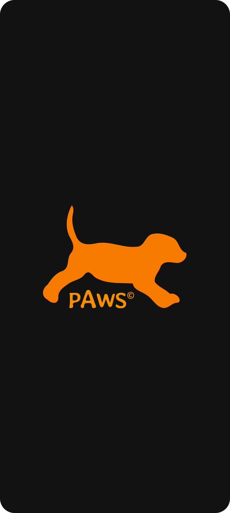
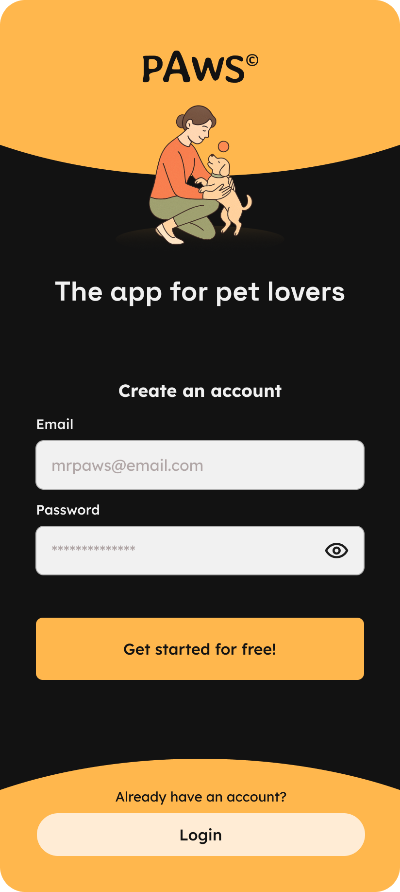
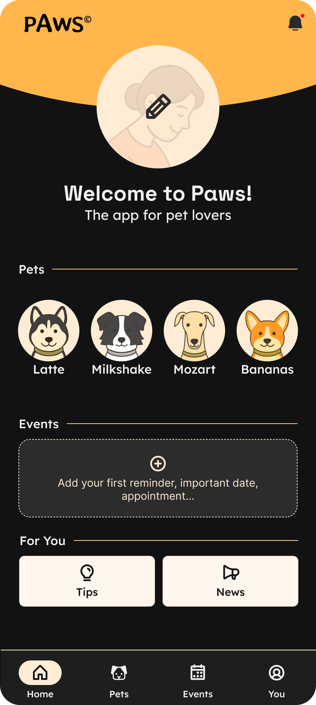
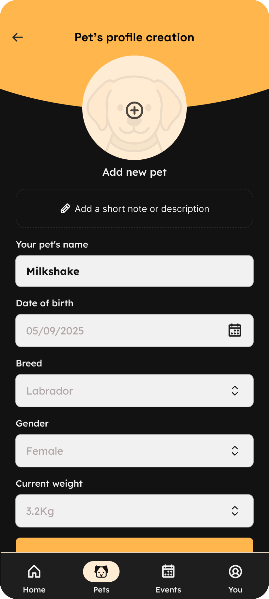

# 🐾 PawsApp — Diseño UI/UX en Figma

**[Probar prototipo en Figma](https://www.figma.com/proto/NQoq2ptitFbeK0Ish35J3c/PawsApp_EK?node-id=8-2&p=f&t=xQSApLGyBGGKsHXK-0&scaling=scale-down&content-scaling=fixed&starting-point-node-id=22%3A667)**

---

## Vistas Principales

  
  
  
  

---

## Concepto y Propuesta de Diseño

**PawsApp** centraliza el cuidado diario de las mascotas, su historial y la conexión con la comunidad local. La identidad visual parte de un logotipo propio con paleta de colores cálidos, ilustraciones amigables e interfaz diseñada en **inglés**.

* **Enfoque UX:** flujo de registro rápido sin fricción, alertas contextuales de bienvenida para personalizar contenidos y navegación inferior clara entre secciones.
* **Prototipado interactivo:** navegación conectada entre pantallas clave, controles de cierre (`X`) y retroceso (`←`), *Bottom Sheets* modales para edición y selección de imágenes, y vistas de detalle.

---

## Recorrido de Usuario en el Prototipo

1. **Onboarding (`Splash` → `Registro` → `Home`):** animación de entrada del logotipo, alta rápida con correo y contraseña, y alerta inicial para completar el perfil.
2. **Pantalla Principal (`Home`):** accesos directos a mascotas, eventos y consejos/noticias, además de un *Bottom Sheet* interactivo para actualizar el avatar del usuario (cámara *front/back*, galería o avatar predeterminado).
3. **Gestión de Mascotas (`Pets` & `Add New`):** listado visual de perros registrados y flujo guiado para crear nuevos perfiles.
4. **Perfil de Mascota (`Pet’s details` & `Media`):** ficha individual con accesos a detalles editables mediante *Bottom Sheet*, notas, registro de cuidados (`Care log`) y galería multimedia con vista de detalle y acciones de gestión.

---

## Herramientas

* **Figma** (diseño de interfaz, componentes reutilizables y prototipado interactivo)
* **Iconstack** (sistema de iconografía)